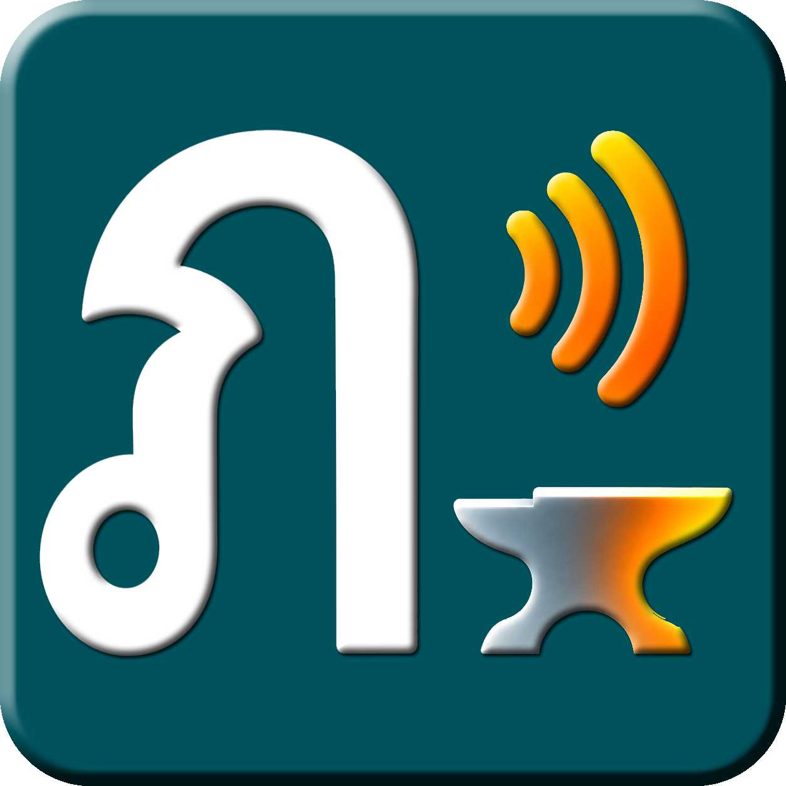

# PhasaForge

**Learn Thai from the words in front of you.**

PhasaForge is a free, Windows desktop companion for studying Thai text. Select text in a supported app, use the keyboard shortcut, and explore the pronunciation, meanings, and sentence structure in a small popup. It is designed for everyday learning, not as a replacement for a full translation service.

> **Release status:** The PhasaForge source is available for public inspection as a **pre-release project**. Version **1.0.0 remains in deployment testing** on [`release/1.0.0`](https://github.com/PopeKael/PhasaForge/tree/release/1.0.0). The default `main` branch is not yet the 1.0.0 release. **No 1.0.0 installer or GitHub release has been published.** Repository source archives are not Windows installers.

## What you can do

- **Read Thai:** Inspect words and sentences, learner romanization, dictionary meanings, examples, and tone details where the spelling permits a reliable analysis.
- **Capture a selection:** Open the movable popup using the configured shortcut (default **Right Ctrl + Up**) or paste text directly.
- **Hear Thai:** Use a Windows/WebView Thai voice, or optionally prepare a local Meta MMS-TTS voice.
- **Translate when needed:** Work offline with bundled dictionary examples, connect your own Microsoft Azure Translator resource, or use a local Ollama model.
- **Practise:** Record, replay, and optionally transcribe short spoken passages. Live transcription and pronunciation scoring are not included.

## Installation

PhasaForge targets **Windows 10/11 x64** and requires **Microsoft Edge WebView2 Runtime**. The release candidate produces NSIS and MSI installers plus a standalone executable, but distribution is on hold until clean-machine acceptance is complete.

For those testing a supplied build, follow the [Windows installation guide](https://github.com/PopeKael/PhasaForge/blob/release/1.0.0/docs/INSTALLATION.md) and verify its checksum before installation.

**Optional components are not bundled:** local MMS speech requires Python 3.10+ and compatible PyTorch/Transformers/NumPy packages plus its separately downloaded model. Local speech recognition and Ollama models also require additional setup. Azure translation needs your own resource and may incur charges under your plan. Offline dictionary lookup does not need an internet connection.

## Project status

The 1.0.0 candidate has passed automated Rust and frontend tests and has been exercised on the developer's installed Windows system, including NSIS reinstall, existing Azure credentials, and Thai playback. **Outstanding release checks** include a live MSI install/uninstall, clean-profile Azure setup, a real Windows sign-in/autostart cycle, and fresh-machine speech prerequisites.

The current state and test limitations are recorded in the [acceptance tests](https://github.com/PopeKael/PhasaForge/blob/release/1.0.0/docs/ACCEPTANCE_TESTS.md). Public source access is not a declaration that the 1.0.0 installers are release-ready.

## Documentation

- [Installation and first-run setup](https://github.com/PopeKael/PhasaForge/blob/release/1.0.0/docs/INSTALLATION.md)
- [Current acceptance record](https://github.com/PopeKael/PhasaForge/blob/release/1.0.0/docs/ACCEPTANCE_TESTS.md)
- [Changelog](CHANGELOG.md)
- [Product specification](docs/PRODUCT_SPEC.md) and [architecture](docs/ARCHITECTURE.md)
- [Build and release guide](docs/BUILD_AND_RELEASE.md)
- [Support and safe bug reports](SUPPORT.md)

## Development

On Windows, with Node.js, Rust/MSVC and the required Tauri build tools installed:

```powershell
npm ci
npm run tauri dev
```

Production builds and signing require additional steps described in the [release guide](docs/BUILD_AND_RELEASE.md). Do not commit credentials, signing keys, recordings, private text, or model weights.

## Privacy and licensing

Dictionary lookup and stored examples work locally. If you request translation through Azure, the relevant Thai text is sent to Microsoft. Local Ollama runs through your configured local service. Settings, history, and recordings are stored in the Windows user's application data.

The **application source is MIT licensed** ([LICENSE](LICENSE)); bundled dictionary data and optional speech models have separate licenses. See the [third-party notices](https://github.com/PopeKael/PhasaForge/blob/release/1.0.0/THIRD-PARTY-NOTICES.md). In particular, the optional Meta MMS-TTS model is **CC BY-NC 4.0** and is not bundled.

## Help and community

PhasaForge is part of [Garage Alchemy](https://garage.dia.net.au/), where Wazza shares practical tools and experiments. For bugs or suggestions while the PhasaForge issue tracker is not public, use [Wazza Garage issues](https://github.com/PopeKael/wazza-garage/issues) and start the title with `PhasaForge:`. See [SUPPORT.md](SUPPORT.md) for what to include. Never post private Thai text, recordings or credentials.

### Support the workshop ☕

PhasaForge is an independent project shared through [Garage Alchemy](https://garage.dia.net.au/). **Support is entirely optional. No payment or subscription is required to use PhasaForge.** If you would like to support Wazza's work:

[**Buy Me a Coffee ☕**](https://buymeacoffee.com/warrengerdes) · [**Join the Tribe on Patreon**](https://www.patreon.com/c/chanyawazza)

These contributions support the independent project maintainer and community, not the authors or maintainers of upstream software, dictionaries, or speech models.
